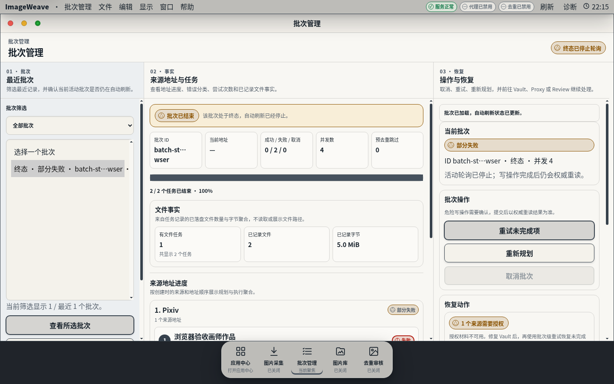

# ImageWeave



ImageWeave 是一个在本机运行的插画与图库采集工作台。它通过桌面式 WebUI，把跨站来源发现、
[gallery-dl](https://codeberg.org/mikf/gallery-dl) 批次下载、任务管理、代理与站点授权，以及图片去重审核整合在一起。
WebUI 由后端直接提供，不需要 Node.js、npm 或单独启动前端服务。裸 `/ui/` 打开空玻璃桌面；应用可从
Dock、应用中心或 `#/应用ID` 深链接启动。

WebUI 的唯一正式视觉是深色“夜航玻璃”：六个内置夜景使用径向光井、单层全局噪点和无色低透明玻璃；
场景与动效偏好只保存在浏览器本地。它面向桌面工作流，至少需要 `1180 × 720` CSS 像素；低于该边界时
只显示环境阻断提示，不提供手机或平板布局。

> 自动化工作流覆盖 Linux x86_64 与 Windows x64 纯 CPU 快速门槛；真实模型闭环配置为每周及手动运行。
> 仓库也提供 NVIDIA CUDA 12.8 安装脚本，但 CUDA 路径尚未纳入现有 CI。

## 核心功能

- 聚合搜索 X / Twitter、Pixiv、Danbooru、E-Hentai / ExHentai 与 Pawchive；
- 筛选搜索结果并创建顺序下载批次；
- 查看任务进度，取消任务，补齐失败下载或重新爬取；
- 在 WebUI 中管理抓取代理池、站点授权和每站运行策略；
- 使用 SHA-256、像素哈希、pHash、SSCD 与 DINOv2 分层发现重复图和相似变体；
- 在去重审核界面比较候选、保存保留决定并整理文件；
- 通过系统诊断查看后端、下载器、代理和去重组件状态。

应用中心列出 10 个应用：8 个真实应用覆盖上述能力，其中“外观设置”只在本地管理六个内置夜景与
动效开关；“图片库”和“数据集导出”是 2 个独立的前端预览，正式运行路径发送 0 个对应业务 API 请求。
预览界面明确显示后端尚未接入，写入操作禁用；测试夹具中的内容态和 Quick Look 只用于隔离测试，
不进入生产 WebUI。

## 运行要求

- Python 3.11–3.14；
- Git，以及完整初始化的 `gallery-dl-codeberg` submodule；
- 安装依赖、Mihomo 和去重模型所需的网络与磁盘空间；
- 使用 X、Pixiv 或 ExHentai 托管授权时，需要 Chrome 或 Chromium；
- 使用 CUDA 模式时，需要 NVIDIA GPU 和兼容 CUDA 12.8 PyTorch 的驱动。

项目会创建两个虚拟环境：

- `gallery-dl-backend/.venv`：WebUI、API、任务调度和下载后端；
- `.venv`：PyTorch、OpenCV 和去重模型。

## 获取源码

```bash
git clone --recurse-submodules https://github.com/KKKneko/ImageWeave.git
cd ImageWeave
```

如果已有源码但 submodule 不完整，请在仓库根目录执行：

```bash
git submodule update --init --recursive
```

## Linux 快速开始

Linux 安装器仅接受 x86_64，并要求系统提供 Python、`venv`、Git、`curl` 或 `wget`、`gzip` 和
SHA-256 校验工具。

Debian / Ubuntu：

```bash
sudo apt update
sudo apt install -y python3 python3-venv git curl ca-certificates gzip coreutils
```

Arch Linux：

```bash
sudo pacman -S python git curl ca-certificates gzip coreutils
```

在仓库根目录安装纯 CPU 环境：

```bash
./scripts/setup-linux.sh --device cpu
```

安装器会初始化 submodule、创建两个虚拟环境、安装锁定依赖、下载并校验 Mihomo 与 SSCD/DINOv2
模型，并在首次运行时创建私有配置 `gallery-dl-backend/config.json`。重复执行不会覆盖已有配置。

NVIDIA CUDA 12.8 环境改用：

```bash
./scripts/setup-linux.sh --device cuda
```

安装过程需要代理时，可以只为本次下载指定 HTTP(S) 代理：

```bash
./scripts/setup-linux.sh --device cpu --proxy http://127.0.0.1:7890
```

查看跳过模型、Mihomo 或其他安装选项：

```bash
./scripts/setup-linux.sh --help
```

安装完成后运行诊断并启动服务：

```bash
./scripts/doctor.sh
./scripts/run.sh
```

然后打开 <http://127.0.0.1:8787/ui/>。停止服务请按 `Ctrl+C`。

使用其他配置文件或端口时，建议让诊断与后端读取同一配置：

```bash
GDL_BACKEND_CONFIG=/path/to/config.json ./scripts/run.sh --port 8788
```

## Windows 安装

Windows 当前没有一键安装器；以下命令需要在仓库根目录的 PowerShell 中执行。Windows x64 纯 CPU
路径已纳入 CI，CUDA 12.8 路径尚未在 GPU runner 上验证。如果 PowerShell 拒绝执行本地脚本，
可以先只为当前进程放行：

```powershell
Set-ExecutionPolicy -Scope Process Bypass
```

先安装后端环境：

```powershell
git submodule update --init --recursive
python -m venv .\gallery-dl-backend\.venv
& .\gallery-dl-backend\.venv\Scripts\python.exe -m pip install `
  --disable-pip-version-check --require-hashes --only-binary=:all: `
  -r .\gallery-dl-backend\requirements.txt
```

再选择一个去重环境；两个命令都会安装锁定依赖并准备 SSCD/DINOv2 模型：

```powershell
# 纯 CPU
.\setup-dedup.ps1 -Device cpu

# 或 NVIDIA CUDA 12.8
.\setup-dedup.ps1 -Device cuda
```

若只想验证锁定依赖、暂不下载模型，可添加 `-SkipModels`；启用去重前必须重新运行不带该参数的命令。

首次创建配置：

```powershell
if (-not (Test-Path .\gallery-dl-backend\config.json)) {
  Copy-Item .\gallery-dl-backend\config.example.json .\gallery-dl-backend\config.json
}
```

复制得到的示例配置默认关闭 WebUI 去重。需要去重时，请编辑 `gallery-dl-backend/config.json`，将
`dedup.enabled` 设为 `true`，并把 `dedup.device` 设为与安装命令一致的 `"cpu"` 或 `"cuda"`。
`gallery.python_executable` 和 `dedup.python_executable` 可以留空，程序会使用上述两个虚拟环境。

只有使用 VLESS、VMess、Trojan 等隧道节点时才需要安装 Mihomo：

```powershell
& .\gallery-dl-backend\scripts\install_mihomo.ps1
```

启动服务：

```powershell
.\gallery-dl-backend\run_backend.ps1
```

打开 <http://127.0.0.1:8787/ui/>；停止服务请按 `Ctrl+C`。

指定其他配置或端口：

```powershell
.\gallery-dl-backend\run_backend.ps1 `
  -Config C:\path\to\config.json `
  -PortOverride 8788
```

## 首次使用

默认服务地址如下：

| 用途 | 地址 |
| --- | --- |
| WebUI | <http://127.0.0.1:8787/ui/> |
| API 前缀 | <http://127.0.0.1:8787/api/v1> |
| Swagger | <http://127.0.0.1:8787/docs> |
| 存活检查 | <http://127.0.0.1:8787/healthz> |
| 完整就绪检查 | <http://127.0.0.1:8787/readyz> |

打开裸 `/ui/` 后先看到空玻璃桌面。使用底部 Dock 的“应用中心”查看全部 10 个应用，或直接点击
Dock 中固定的“图片采集”“批次管理”“图片库”“去重审核”。推荐流程：

1. 从应用中心打开“系统诊断”，确认必需组件可用；
2. 按需在“授权管理”登录站点，在“代理管理”配置抓取代理；
3. 在“图片采集”搜索、筛选并创建批次；
4. 在“批次管理”查看进度或处理失败任务；
5. 批次结束后，在“去重审核”分析目录、选择保留图并应用结果。

窗口可通过左上角交通灯关闭、最小化或最大化。当前聚焦窗口最大化时，Dock 会完全隐藏，窗口从菜单栏
下沿填满到视口底部；恢复、最小化、关闭或切换到普通窗口后，Dock 自动返回，不会浮在窗口上遮挡内容。
WebUI 的 HTML、CSS、JavaScript 与 SVG 保留 ETag/Last-Modified，并要求浏览器每次复用前重新验证；
关键桌面样式另使用显式版本 URL。该交付合同用于避免滚动升级时新 HTML 与旧 CSS/ESM 混用，正常使用
不依赖强制刷新。

关闭或最小化所有窗口后返回空桌面。新页面不会自动重开上次运行的应用，但会为每个应用沿用经过校验的
最近普通窗口位置和可选最大化偏好。

### 站点授权

| 来源 | 授权要求 |
| --- | --- |
| Danbooru | 公共搜索可直接使用，账号或 API key 可选。 |
| Pawchive | 公共搜索和下载无需登录。 |
| E-Hentai / ExHentai | E-Hentai 公共搜索可直接使用；ExHentai 需要有效 Cookie。 |
| X / Twitter | 需要有效登录 Cookie。 |
| Pixiv | 需要 refresh token 或有效登录 Cookie。 |

“授权管理”使用项目专属浏览器 Profile，不会读取日常浏览器 Profile。页面显示“已配置”只代表本地材料存在；
站点可能仍会因会话过期、风控或接口变化拒绝请求。

## 配置

主配置文件为 `gallery-dl-backend/config.json`，可用字段与安全默认值见
[`gallery-dl-backend/config.example.json`](./gallery-dl-backend/config.example.json)。相对路径以配置文件所在目录为基准。

默认下载目录是：

```text
gallery-dl-backend/runtime/downloads/
```

输出到其他磁盘时，必须同时更新默认目录和允许写入的目录：

```json
{
  "default_output_root": "/data/imageweave",
  "allowed_output_roots": ["/data/imageweave"]
}
```

Windows JSON 路径可以写成 `D:/ImageWeave/downloads`。从 CPU 切换到 CUDA 或反向切换后，除了重新运行
对应安装脚本，还要同步修改 `dedup.device`。

### 三类代理不要混用

1. `setup-linux.sh --proxy` / `setup-dedup.ps1 -ProxyUrl`：只影响安装期间的依赖和模型下载；
2. “代理管理”或配置中的 `proxy`：供站点搜索与图片下载使用；
3. “授权管理”或 `auth.authorization_proxy`：只供登录浏览器和授权流程使用。

安装代理不会自动写入抓取代理池。代理订阅 URL、节点凭据、Cookie 和 Token 都不应提交到仓库或公开 Issue。

## 独立使用去重 CLI

完成去重环境安装后，也可以绕过 WebUI 扫描任意目录。建议先用不会移动或删除源图片的模式预览：

Linux：

```bash
./.venv/bin/python ./dedup_core.py "/path/to/images" --device cpu --dry-run --no-gui
```

Windows：

```powershell
& .\.venv\Scripts\python.exe .\dedup_core.py "D:\Images" --device cpu --dry-run --no-gui
```

移除 `--dry-run` 后，自动判定为重复的图片默认会移入其所在目录下的 `duplicates/`；`--delete` 会直接删除文件。
执行实际整理前请先备份，并通过以下命令查看完整选项：

```bash
./.venv/bin/python ./dedup_core.py --help
```

## 安全与使用边界

- 服务只允许监听 `127.0.0.1`、`localhost` 或 `::1`，不支持直接暴露到公网；
- 默认拒绝下载任务访问回环、私网、链路本地和保留地址；
- 不要公开 `gallery-dl-backend/config.json`、浏览器 Profile、Cookie、Token、代理订阅或运行数据库；
- 第三方站点的可用性、登录规则和限流策略可能变化；请遵守站点条款，并确保有权下载和使用相关内容。

## 维护者文档

- [架构与开发约定](./docs/ARCHITECTURE.md)：后端所有权、WebUI 模块/窗口边界和正式门禁；
- [gallery-dl 后端说明](./docs/gallery-dl-backend.md)：运行边界、API、授权、代理、批次与去重流程。

## 许可证

ImageWeave 项目代码采用 [MIT License](./LICENSE)。gallery-dl、Mihomo 及其他第三方组件仍受各自许可证约束。
